# Architecture and product roadmap

## Product boundary

Green Energy Dispatch is a UK energy-software **portfolio prototype**, not an operational dispatch platform. The repository contains a read-only NESO Carbon Intensity adapter, optional PostgreSQL evidence storage and collector, deterministic EV-depot scheduling strategies, synthetic evaluation tools, and a React operator dashboard.

The public demo at <https://green-energy-dispatch-dashboard.onrender.com> is narrower: a Docker-built React/Vite frontend and FastAPI are served from one origin. Its simulation-only boundary accepts a bounded synthetic evaluation; it does not feed NESO data into the scheduler, persist submitted scenarios, control a charger, or make market decisions. Synthetic carbon proxies are not measurements or verified emissions outcomes.

The owner-provided deployment log explicitly records that the existing service checked out application commit `55ae4f274848ac3642e1e0bf804feba7f07b8659` from `main` and reached Live status. This records the deployment event; it is not an independent readback of the service's current Dashboard state. The current Compute Plan and Auto-Deploy state remain unconfirmed. The diagram and repository configuration describe application topology, not proof of provider-side settings.

## System context

```mermaid
flowchart TB
  subgraph Demo["Existing public simulation-only demo"]
    Browser["Browser: React and Vite production build"]
    Service["Existing Render Docker web service<br/>one public origin"]
    API["FastAPI serves index.html, assets and SPA fallback"]
    Guard["PublicDemoGuardMiddleware<br/>route, method, body-size and rate limits"]
    Schema["Pydantic scenario validation<br/>synthetic provenance required"]
    Baseline["Immediate Baseline"]
    Heuristic["Carbon-Aware Heuristic<br/>EDF seed plus bounded shifts"]
    Compare["Equal-service comparison<br/>proxy values and provenance"]
    Browser -->|"same-origin requests"| Service
    Service -->|"static UI / SPA fallback"| API
    Service -->|"POST /api/v1/simulations/ev-depot/evaluate"| Guard
    Guard --> Schema
    Schema --> Baseline
    Schema --> Heuristic
    Baseline --> Compare
    Heuristic --> Compare
    Compare --> Browser
  end

  subgraph Local["Separate repository capabilities; not connected to the public scheduler"]
    NESO["NESO Carbon Intensity API<br/>read-only HTTPS"] --> Adapter["Local FastAPI adapter"]
    Adapter --> Clients["Local API clients"]
    NESO --> Collector["Optional standalone collector"]
    Collector --> Store["Optional PostgreSQL evidence store"]
  end
```



The Docker build compiles the Vite application and copies `frontend/dist` into the FastAPI runtime image. With `SERVE_FRONTEND=true`, FastAPI serves the root document, same-origin assets, and the SPA history fallback. The local development topology remains different: Vite runs separately and proxies `/api` and `/health` to a loopback FastAPI server.

## Implemented components and deployment status

| Component | Responsibility | Status and boundary |
|---|---|---|
| FastAPI health route | `GET /health` | Implemented; reports application health, not the deployed source revision. |
| Public simulation guard | Exact API route/method allowlist, request-size limit (65,536 bytes), process-local rolling rate limit (60 requests/minute by default) | Implemented for simulation-only mode. The in-memory rate limit is not coordinated across instances and resets on process restart. |
| Simulation API | `POST /api/v1/simulations/ev-depot/evaluate` | Implemented; stateless, Pydantic-validated, synthetic-only, with no database or upstream calls. |
| EV-depot strategies | Immediate Baseline and bounded Carbon-Aware Heuristic | Implemented; advisory simulation, not a global optimiser or proof of infeasibility. |
| React/Vite dashboard | Scenario editing, JSON import/export, API-backed comparisons, charts and accessible tables | Implemented; production build is served by FastAPI in the Docker demo, while local development uses Vite. |
| NESO adapter | Read-only HTTPS regional request, parsing, provenance, freshness, bounded timeout and upstream error handling | Implemented as a separate local/API capability; not used by the public scheduler. The public smoke test verified the documented live-data routes return 404. |
| PostgreSQL evidence store and replay | Immutable source evidence, normalised observations, explicit migrations, one-shot ingestion and offline replay | Implemented as optional local components; not provisioned for the public simulation demo. |
| NESO collector | Standalone opt-in polling, bounded retries, persisted run/attempt status, gap reporting and graceful stop | Implemented for local use; separate process, not a production scheduler and not part of the public demo. |
| Historical datasets and baselines | Deterministic exports and chronological persistence/seasonal-naive evaluation | Framework implemented; the previously inspected project database had no observations, so no genuine historical forecast evaluation is claimed. |
| Existing Render demo | Single-origin Docker service at the public URL | Owner-provided deployment log records commit `55ae4f274848ac3642e1e0bf804feba7f07b8659` from `main` and Live status; current Dashboard readback, Compute Plan and Auto-Deploy remain unverified. |
| Production operations and actuation | SLOs, alerting, backups, live assets, market interaction | Not implemented. |

## Public deployment and operational limits

The public demo is a portfolio deployment, not production service evidence. Its checked-in `render.yaml` describes a Free-plan Docker service named `green-energy-dispatch-staging`, with `branch: main` and `autoDeployTrigger: "off"`. The existing dashboard service is named `green-energy-dispatch-dashboard`; the YAML does not verify or control that service's current settings. Do not sync the differently named Blueprint as part of release packaging: it could propose a separate resource. Provider settings must be read from the existing service's Dashboard.

The smoke confirms that the public endpoint responds, but does not identify its serving SHA. The owner-provided deployment log records the deployment source as commit `55ae4f274848ac3642e1e0bf804feba7f07b8659` from `main`; independently confirm the currently active SHA in the existing Render Dashboard before describing it as current state. The live Compute Plan and Auto-Deploy setting have not been confirmed. If the existing service uses the intended Free tier, cold starts, ephemeral filesystem behaviour, workspace quotas and provider-term changes may constrain availability; check current account usage and terms before making cost or uptime claims. The 512 MB / 0.1 CPU CI container smoke is a bounded startup-and-one-scenario check, not a load or peak-memory test.

## Scheduled data operations

The collector is a separate `python -m app.collect_neso run` process; FastAPI lifespan does not create a scheduler. It is disabled unless `COLLECTOR_ENABLED=true`, polls one configured region immediately and then waits a fixed interval (default 30 minutes) after each completed cycle. Sequential execution and a per-region PostgreSQL advisory lock prevent overlapping or duplicate local workers. `SIGINT`/`SIGTERM` stops the poll loop and interrupts waits/backoffs; active requests finish within the bounded NESO timeout.

Transient network failures, HTTP 429 and HTTP 5xx responses use a bounded configurable retry policy. `Retry-After` is honoured for in-cycle retries; when its deadline exceeds the per-cycle backoff cap, the worker defers later requests until the persisted deadline, including after restart. Cooldown waits are interruptible by graceful shutdown. Validation and persistence failures are not retried. Each request attempt and each poll cycle is stored in a small versioned operational schema; `python -m app.collect_neso status` reports the current advisory-lock state, latest attempt/success, source retrieval/interval, actual/forecast and freshness fields, duplicate/new evidence outcomes, consecutive failed cycles, and interval gaps. Operational state is not a replacement for logs or an alerting system.

The regional endpoint provides a limited latest response, not a complete historical export. The collector stores only evidence actually returned, reports complete gaps between successful interval boundaries, and never fills missing periods. A repeated interval may have newly retained retrieval evidence; status distinguishes raw evidence insertion, normalised observation insertion, and duplicate interval. The 30-minute default matches the interval granularity used by this feed; it does not guarantee complete coverage or uptime. See [`DATABASE_AND_REPLAY.md`](DATABASE_AND_REPLAY.md) for exact local commands, failure recovery and limitations.

## Historical datasets and baseline evaluation

The project-local PostgreSQL database inspected for this milestone was `ged` on the local development service. It had only `alembic_version` at revision `0001_neso_evidence`; `raw_payloads` and `carbon_observations` did not exist, so it exposed **zero historical observations** (zero actuals and zero forecasts) and no real-data period for forecast evaluation. This is a time-of-inspection snapshot, not a claim about other databases or later collection runs. Fixtures used in automated tests are synthetic, explicitly test-only examples and their metrics are not forecast-performance evidence.

The historical dataset builder reads validated, normalised observations joined to their raw-payload provenance. It exports one requested region, converts interval and retrieval timestamps to UTC, and derives units from the persisted source API identifier without numerical conversion: the existing live NESO API retains its established `gCO2e/kWh` label, while the NESO forecast archive is `gCO2/kWh`. Each CSV and JSON observation carries its own unit. Dataset and availability metadata expose `units: null` plus per-unit/per-source summaries when exported rows contain multiple units; actual revisions in different units cannot be collapsed into one canonical interval. Rejected payloads are counted but never emitted as accepted dataset rows. Canonical actual selection, persistence and seasonal-naive source selection share the same revision precedence: latest eligible retrieval time, then lexicographically greatest payload SHA-256, then greatest raw-payload ID. The canonical JSON hash also retains all accepted actual revision evidence for as-of-time evaluation. Forecast records are retained separately by retrieval. The manifest reports duplicate/conflicting actual revisions, missing UTC half-hour bins, actual/forecast coverage and contiguous actual spans. Missing intervals are not interpolated.

The evaluation CLI uses a chronological fraction split or an explicit timezone-aware cutoff, splitting all revisions of an interval together. Fraction splits keep at least one unique interval on each side when two or more are available. It reports persistence and seasonal-naive baselines for configured half-hour horizons, MAE/RMSE in the report’s explicit unit, sample counts, target period and skipped inputs. Actual observations from mixed unit contracts are marked insufficient and are never compared or converted. Evaluation is rolling-origin within the holdout: forecast origins earlier than the first test interval are excluded, so the first `horizon` test targets are warm-up rather than scored samples. An earlier test-period actual may be used at a later test forecast origin, but only when its interval has ended and its retrieval time is no later than that origin. The latest eligible revision is chosen for each source interval using the same retrieval/hash/raw-ID precedence as canonical dataset selection; future actuals and future retrievals cannot be used. The JSON report lists requested and adequately evaluated horizons/methods and an unavailable reason for each method/horizon pair without valid samples. The evaluated horizon and method lists are independent summaries: each includes a value when at least one corresponding pair meets the sample threshold; use the pair-level result, unavailable and insufficient-sample entries for exact coverage. Metrics are retained when computed, including those below the configurable minimum evaluation sample count (default two), and identified in `insufficient_sample_evaluations`. `sufficient_data` is true only when every requested pair meets that sample threshold and the training/test requirements are met. These explainable baselines are an evaluation framework, not a trained production model.

Use `python -m app.build_historical_dataset --region-id 13 --output artifacts/region-13.csv` to create the CSV and JSON manifest, and `python -m app.evaluate_historical_baselines --region-id 13 --train-fraction 0.8 --horizons 1,2,4,48` to evaluate if the stored actuals support it. Both commands require `DATABASE_URL` for a database already migrated to the current schema. The inspected local database was not migrated past `0001`, so these commands require upgrading it before use. Integration tests use disposable PostgreSQL schemas with real Alembic migrations and labelled fixtures; they do not call the live NESO API.

The official NESO Regional Carbon Intensity Forecast archive is forecast-only: its rows have target timestamps but no original forecast issue time, and the inspected London API historical response also contained forecasts rather than regional actuals. A bounded, read-only-by-default DataStore acquisition command is available; `--persist` explicitly stores source evidence and forecast rows using the existing schema. These retrospectively acquired forecasts are not valid historical as-of inputs, and the archive cannot supply actual targets for genuine regional forecast evaluation. Source evidence, licence attribution, coverage observations and commands are documented in [`NESO_HISTORICAL_ACQUISITION.md`](NESO_HISTORICAL_ACQUISITION.md). No user-managed database is needed by the operator dashboard. The dashboard milestone's full integration suite was run against a temporary, volume-less local PostgreSQL service that was stopped and removed after verification; no existing or user-managed database was modified.

## Data contract and provenance

Each response includes region ID, measurement kind (`actual`/`forecast`), interval status (`upcoming`/`in_progress`/`completed`), interval bounds, retrieval time, age from interval start, lag since interval end, freshness flag, source API name, and exact request URL. Optional persistence stores both canonical raw JSON evidence and normalised values, linked by source-payload provenance and SHA-256. Raw evidence is immutable; repeated submissions are idempotent. Replay verifies stored bytes and reuses the existing parser offline with original retrieval-time context. See [`DATABASE_AND_REPLAY.md`](DATABASE_AND_REPLAY.md) for details and limits.

Freshness is bounded by `NESO_MAX_AGE_SECONDS` measured from interval start. A completed interval is not automatically stale: a recent `actual` may be returned as the latest estimate within that age limit. A completed `forecast` is returned explicitly with `interval_status=completed` and `is_fresh=false`; future forecasts are identified as `upcoming`. Readings older than the configured age limit remain rejected. `interval_lag_seconds` measures time after the interval ended; the API response does not expose a separate publication timestamp, so this is not a measured publication delay. The source may have publication latency that cannot be independently quantified from this payload. Persistence retains canonical JSON evidence, not the original HTTP wire bytes/headers.

Default region ID is 13. Confirm/change it for the intended GB operating region before relying on location-specific results. The adapter does not infer a location from user identity or IP.

## Security and runtime assumptions

- NESO access is read-only over HTTPS; redirects are disabled.
- Production defaults use `APP_ENV=production`, `DEBUG=false`; debug is rejected in production.
- Interactive API documentation is disabled unless debug is explicitly enabled in a non-production environment.
- Upstream network timeout and freshness thresholds are bounded settings.
- API and collector containers use a non-root UID, read-only filesystem, dropped capabilities, and `no-new-privileges`; the API image has a health check. PostgreSQL binds to loopback only in the local Compose overlay.
- Optional development PostgreSQL is isolated behind a Compose profile and bound to loopback only; database migrations are explicit CLI operations.
- CI runs tests, lint, dependency audit, secret scanning, and container vulnerability scanning.
- No secrets are required for the NESO endpoint.

## NESO Carbon Intensity API

The service requests the NESO documented regional endpoint `/regional/regionid/{regionid}` over HTTPS. The feed includes interval bounds and actual/forecast intensity values. This is a read-only carbon-intensity feed; it is not a price forecast, a dispatch instruction, or a control signal. See the [official NESO Carbon Intensity API documentation](https://carbon-intensity.github.io/api-definitions/).

## Illustrative simulated carbon policy

```text
≤150 gCO₂e/kWh      allow
>150 and ≤300       defer
>300                block
```

This is a software demonstration, not an energy-market rule, safety controller, or validated commercial recommendation. Keep policy thresholds configurable/versioned and do not connect actuation without separate engineering, legal, safety, and operational review.

## Decisions

### Provenance and freshness before optimisation
Data correctness and source traceability precede forecasts. A stale upstream response must not be silently represented as real-time.

### Baseline before complex ML
Establish historical, leakage-safe baselines and operating metrics before comparing more complex forecasting models. Model complexity is justified by measured improvement, not appearance.

### Separate recommendation from execution
The platform can explain a recommendation without having authority to perform a physical or financial action. This boundary remains explicit in APIs and UI.

### React/Vite client with same-origin API
The operator dashboard is a focused React/TypeScript application built by Vite. In local development, Vite proxies `/api` and `/health` to the loopback FastAPI server. In the Docker demo, FastAPI serves the production Vite build and API from the same origin; neither topology requires permissive CORS. OpenAPI-derived TypeScript types are generated during the build. The public simulation-only runtime disables interactive API documentation. See [ADR-001](decisions/ADR-001-react-vite-operator-dashboard.md) for the original local-development alternatives and trade-offs.

## Staged product roadmap

1. **Data foundation (implemented):** optional PostgreSQL storage of raw payloads and normalised observations with source hash, retrieval time, interval, freshness result, schema version, explicit migrations, one-shot idempotent ingestion, and offline deterministic replay.
2. **Data operations (local collector implemented):** opt-in scheduled polling, bounded retry/backoff, 429 handling, per-attempt status, freshness and interval-gap reporting, and graceful shutdown. Production-grade scheduling, backfill, alerting, retention, and backup/restore remain planned.
3. **Forecasting (partially implemented):** a provenance-aware dataset and chronological persistence/seasonal-naive evaluation framework are available; meaningful real-data evaluation, further error/calibration evidence, model cards and monitored inference remain future work. Add neural models only when measured baselines justify them.
4. **EV-depot simulation (implemented):** reuse the existing baseline and bounded carbon-aware heuristic for explicitly synthetic, price-free scenarios; the heuristic is not a global optimizer and failure is not an infeasibility proof.
5. **Operator dashboard (implemented locally and hosted as a limited demo):** React/TypeScript edits synthetic inputs, calls the FastAPI simulation endpoint, and visualises validated Python results. NESO data is deliberately not connected to this scheduler. Hosting does not imply production operations or support.
6. **Next planned milestone:** v0.2.0 is planned for a separate branch from the final v0.1.0 release main and will introduce real NESO data and forecast-backed scheduling. That scope is not included in this synthetic-only demo and requires separate provenance, safety, security, and review.
7. **Production readiness:** a limited public demo exists, but production SLOs, alerting, backups, high availability, operational access control, and production security review remain future work.

## Release acceptance evidence

- Post-merge Actions run [40193307594](https://github.com/vlad12-k/green-energy-dispatch-dashboard/actions/runs/40193307594) passed `quality`, `frontend-quality`, `container`, and `secret-scan` on application commit `55ae4f274848ac3642e1e0bf804feba7f07b8659`. See [the workflow](../.github/workflows/ci.yml) for exact gates; Trivy coverage is CRITICAL/HIGH, not all severities.
- The bounded live smoke command `python scripts/smoke_staging.py --base-url https://green-energy-dispatch-dashboard.onrender.com` exited `0` from a clean detached checkout at that source SHA. It verified health, built assets/history fallback, one synthetic evaluation, provenance/claim flags, and selected disabled routes.
- The owner-provided deployment log explicitly records checkout of `55ae4f274848ac3642e1e0bf804feba7f07b8659` from `main` and Live status. This is log evidence, not an independent readback of the current active Dashboard state. The current Compute Plan and Auto-Deploy remain unverified; do not infer them from `render.yaml`.
- The earlier dashboard screenshots and local visual QA remain explicitly local Chrome/Playwright evidence. Safari desktop/mobile acceptance is still required before claiming Safari compatibility or using new captures as live evidence.

A completed release stage should retain automated test output, a reproducible synthetic example, exact commit-bound CI evidence, provider-side deployment metadata, and visual evidence with its browser/viewport provenance. Do not turn implementation documents or screenshots from another environment into live acceptance claims.
