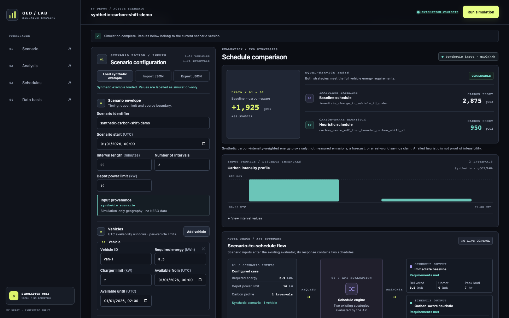
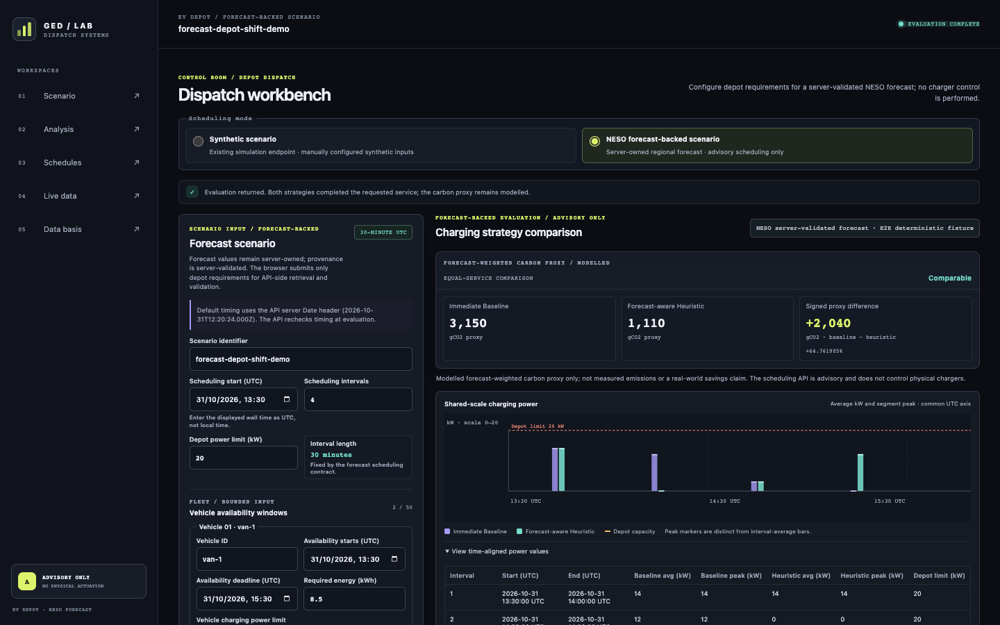
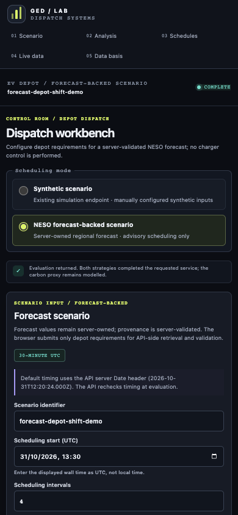
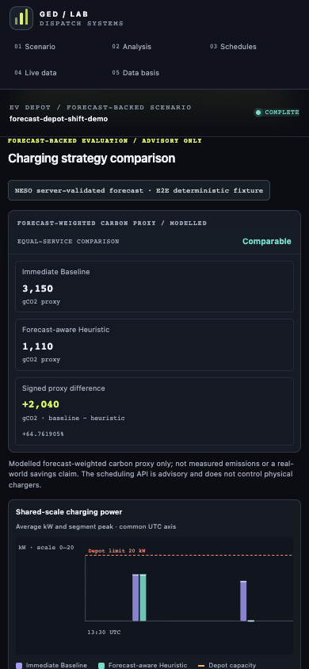

# Operator dashboard: local guide

## Purpose and safety boundary

The Operator Dashboard is a locally runnable interface with two explicitly selected scheduling modes: **Synthetic Scenario** and **NESO Forecast-backed Scenario**. Synthetic scenarios use `POST /api/v1/simulations/ev-depot/evaluate`; forecast-backed scenarios use `POST /api/v1/simulations/ev-depot/forecast-evaluate`. The browser sends bounded depot requirements only. FastAPI retrieves and validates the configured regional forecast and owns its provenance. The separate live-reading panel uses read-only `GET /api/v1/energy/carbon-intensity`; the optional forecast preview uses a separate read-only `GET /api/v1/energy/carbon-intensity/forecast?region_id=...`. Neither display request supplies the scheduling API's independently retrieved forecast.

Both scheduling modes are advisory and price-free. Neither writes to a database, controls chargers or hardware, trades electricity, measures real-world emissions, proves infeasibility, or guarantees a global optimum. The synthetic mode uses synthetic carbon inputs only. Forecast-mode carbon values are modelled forecast-weighted energy proxies, not measured emissions or verified savings; a lower proxy is not a benefit when service delivery is incomplete. The live reading and optional forecast preview are display-only and are not inputs to either scheduling mode.

The current public demo remains the v0.2.0 Phase A deployment: the existing synthetic evaluation route and separate read-only NESO display. Merged B1/B2 code includes the forecast timeline, forecast-backed scheduler and stateless evaluation API. This branch is the Phase B3 React integration candidate; it is **not deployed**. The existing Render service is unchanged. The demo has no user authentication or production-operations boundary.

## Requirements and startup

- Python 3.12 or newer with the repository runtime requirements installed.
- Node.js 22.12 or newer and npm.
- No database, cloud account, or external UI service.
- No credentials are needed. Synthetic scheduling works offline. The live panel, forecast preview and forecast-backed evaluation need outbound HTTPS from FastAPI to the public NESO API and show explicit unavailable/error states when requests fail. Deterministic browser E2E replaces the NESO reader with a test-only fixture; it does not require live NESO availability.

From the repository root, start the API:

```bash
python -m uvicorn app.main:app --reload --host 127.0.0.1 --port 8000
```

In a second terminal:

```bash
cd frontend
npm ci
npm run dev
```

Open <http://127.0.0.1:5173>. Vite serves the frontend and proxies `/api` and `/health` to the loopback API at port 8000. The browser sees a same-origin request; FastAPI does not enable wildcard CORS. Both processes bind to loopback for local use.

## Operator workflow

1. Select **Load synthetic example**. The initial example is also loaded on first page view and is labelled simulation-only.
2. Edit the scenario identifier, UTC start, interval length/count, depot limit, vehicle windows and energy/power limits, or per-interval synthetic carbon intensity.
3. Add/remove vehicles, or import a local JSON file conforming to the EV-depot scenario contract. Client-side import limits files to 256 KiB; authoritative scenario validation remains in FastAPI.
4. Select **Run simulation**. The dashboard submits the current scenario to the real API. Editing during an in-flight request cancels/invalidates it; stale responses cannot replace newer input state.
5. Review the **Immediate Baseline** and **Carbon-Aware Heuristic** schedules, allocation segments, interval-average and peak depot power, required/delivered/unmet energy, constraint checks and comparison eligibility.
6. Select **Export JSON** to download the current scenario inputs. Exports contain no result data or credentials.

### Forecast-backed workflow

1. Select **NESO forecast-backed scenario** explicitly. The bounded editor defaults from the API `Date` header when available and uses UTC-aligned 30-minute intervals, up to 48 intervals and the API's vehicle limit.
2. Edit the scenario identifier, UTC scheduling start, horizon, depot limit, vehicle availability windows, required energy and per-vehicle charging power limits. Deadlines are not silently shifted; FastAPI remains authoritative.
3. Select **Evaluate forecast schedule**. The browser submits only `{ "scenario": ... }`; it cannot supply forecast observations, trusted provenance, an arbitrary region or a synthetic fallback. The server independently retrieves/validates forecast evidence for the requested horizon.
4. Optionally select **Load regional forecast preview** after the server has supplied a verified region. This is a separate, operator-triggered read-only timeline request. It is not passed into the evaluation and does not trigger polling.
5. Review the Immediate Baseline and Forecast-aware Heuristic on one UTC axis, the capacity reference, vehicle allocations/deadlines, delivered and unmet energy, reported constraints, forecast-weighted proxies and comparison eligibility. Numeric tables accompany the charts. An incomplete strategy makes an equal-service proxy comparison unavailable.

The **Live carbon intensity** panel loads independently when the page opens and refreshes every 60 seconds; use its **Refresh** control for a manual request. It labels region, intensity and raw reported units, actual/forecast source, observed interval, retrieval time and age/freshness. A stale completed forecast or a failed refresh is explicitly marked; when no valid reading exists, the panel shows unavailable without substituting a value. This read-only section does not alter either mode's inputs or scheduler strategy.

After any edit, prior results are hidden until that exact input version has been evaluated. Editing during an in-flight request aborts it and stale responses are ignored. Forecast 422 validation, 429 rate limiting, 503 forecast unavailability, timeout and network failures are shown explicitly without switching to the synthetic endpoint or exposing internal exception details.

## Reading the results

- Vehicle allocation bars represent actual response `segment_start`/`segment_end` and per-vehicle allocated energy. Their tables provide exact segment times, energy, average power, and intensity.
- Depot charts distinguish interval-average power, segment peak power, and the depot capacity reference. Average power is not presented as instantaneous power.
- Carbon-intensity profile chart and table use the edited synthetic inputs; they are not NESO observations or forecasts.
- Per-strategy proxies retain the input unit (`gCO2` or `gCO2e`). The signed comparison is **Immediate Baseline proxy − Carbon-Aware Heuristic proxy**: positive, zero, and negative values are all retained.
- A comparison is eligible only if both schedules fulfil the same complete vehicle energy requirements. When it is not eligible, the reason is shown; a lower proxy from reduced delivery is never described as a benefit.
- Constraints and status use text as well as colour. Expand the data tables for numerical alternatives to the charts.
- Energy, power, and proxy values use up to six decimal places; very small or very large values use scientific notation, and true zero remains `0`. A non-zero shortfall is therefore not rounded into an exact zero.
- Schedule charts choose a responsive set of at most five UTC time ticks. Their focusable, scrollable viewport keeps large fleets manageable; accessible interval tables retain every interval's UTC bounds, and allocation tables retain every returned segment and its timestamps.

## API contract and OpenAPI types

`POST /api/v1/simulations/ev-depot/evaluate` accepts the existing `CarbonAwareDepotScenario` fields and returns `CarbonAwareSimulationResult`. The HTTP input adapter accepts ISO-8601 timestamp strings and delegates all other domain constraints to the existing strict Pydantic scenario model. The response includes the existing strategies, detailed segment allocations, load and constraint results, provenance, and comparison fields.

The API enforces a maximum of 96 intervals and 50 vehicles, and retains the existing synthetic-only provenance rules. Invalid inputs return FastAPI's structured HTTP 422 validation response. The endpoint is synchronous, bounded, stateless, and does not fetch NESO data or access persistence.

The merged Phase B2b API is integrated by this Phase B3 React candidate at `POST /api/v1/simulations/ev-depot/forecast-evaluate`; this branch is **not deployed**. Its strict request contains `scenario` (the existing depot scenario shape) and permits `neso_region_id` only as an optional assertion of the server-configured region. The UI sends only `scenario`. The API rejects client forecast values, external URLs, retrieval/decision timestamps, provenance and result objects. The scenario is bounded to 30-minute intervals, at most 48 intervals and 50 vehicles. FastAPI fetches through `CachedNesoCarbonIntensityReader`, captures decision time after retrieval and reuses the B2a `schedule_forecast_backed()` implementation; it does not call the B1 HTTP route internally. It fails closed unless validated forecast evidence covers the full scheduling horizon. HTTP 200 with `status: "available"` can include incomplete schedules but comparison is ineligible and proxy differences are omitted unless both strategies complete equal service. HTTP 422 reports invalid client fields/time/region assertion; HTTP 429 is rate limiting; HTTP 503 reports forecast evidence missing, stale, invalid or unavailable. The client does not fall back to the synthetic endpoint. The route is stateless, does not persist results or actuate equipment, and uses `Cache-Control: no-store`.

The optional B1 preview request is `GET /api/v1/energy/carbon-intensity/forecast?region_id=...`. The client sends only a region ID obtained from a validated application response or verified forecast result, then validates the returned 48 half-hour intervals, official source URL, region, units and forecast provenance. Retrieval time is shown as retrieval time; the UI does not assert an original NESO issue timestamp.

For the simulation-only candidate, the guard applies the configured body-size bound and a dedicated process-local rate cap of 5 forecast evaluations per minute by default. Each forecast POST also consumes the shared NESO bucket (60 requests/minute by default), including cache hits. Buckets are shared across visitors within a process, not coordinated across replicas, and do not provide user authentication or per-user authorization. Full request, response, freshness, timing, rate-limit and failure semantics are documented in [`FORECAST_BACKED_SCHEDULING.md`](FORECAST_BACKED_SCHEDULING.md).

The independent `GET /api/v1/energy/carbon-intensity` contract returns one validated reading for the configured `NESO_REGION_ID` (default 13), including raw NESO `gCO2/kWh` units, actual/forecast provenance, observed interval, retrieval timestamp, age, freshness and source URL. It takes no request body or caller-controlled region/URL, does not persist data, and has no connection to the synthetic simulation request path. It reuses the existing client, with `NESO_API_BASE_URL` restricted to `https://api.carbonintensity.org.uk`, `NESO_TIMEOUT_SECONDS` bounded to 30 seconds, a maximum 64 KiB upstream response and an at-most-30-second freshness-aware process cache. The public API and browser client mark unavailable/error states explicitly; stale/error responses are not publicly cached.

TypeScript schema definitions are generated from the FastAPI OpenAPI document:

```bash
cd frontend
npm run generate:api
```

This imports the local Python application to generate an ignored intermediate OpenAPI JSON file, then runs the locked `openapi-typescript` generator into `src/api/schema.d.ts`. The schema file is committed so IDEs and tests can use the contract; `npm run build` regenerates it before type-checking.

The default API URL is the same-origin relative path `/api`. `VITE_API_BASE_URL` is an optional prefix for a same-origin configuration. Cross-origin deployment is not configured and must not be enabled by adding permissive CORS defaults.

## Development checks

From `frontend/`:

```bash
npm run lint
npm run typecheck
npm test
npm run build
npm run test:e2e:guard
npm run test:e2e
```

Vitest/Testing Library cover both modes, endpoint isolation, request contracts, UTC/bounds validation, forecast provenance, UTC half-hour timeline bounds, response-server-Date chronology with a bounded two-second HTTP Date/response-handoff tolerance, and currentness-unverified/unavailable states. The timeline preview does not infer freshness from the browser clock or an unconfigured age threshold; a failed refresh marks a retained snapshot's currentness unverified. Tests also cover the server contract's one-hour forecast-age boundary, shared-interval intensity consistency, comparison eligibility, API 422/429/503/network/timeout failures (including bounded request and body-read timeout classification across the simulation, forecast evaluation, forecast timeline and live carbon-intensity requests), cancellation/stale results, late server-clock updates during evaluation and the preserved synthetic flow. The forecast preview OpenAPI contract documents the HTTP 503 unavailable response as JSON with a string `detail`. `npm run test:e2e:guard` verifies occupied-port rejection, non-reuse, fixture identity validation (including a stalled-response timeout) and preservation of any existing listener. Playwright starts only its own Vite and real FastAPI public routes plus scheduler; it pins the Vite API base to same-origin, blocks and records any off-origin browser request before network access, checks the deterministic fixture identity before browser navigation, and uses `scripts/e2e_fastapi.py` to replace the upstream reader and install a deny-all NESO HTTP transport. The E2E suite checks that no off-origin browser request or NESO transport request was attempted. It asserts the actual local POST body/200 response and separate forecast GET/200 response, as well as chart/table content, keyboard focus, mobile results-heading clearance below the sticky header, and 1440px/390px/320px layouts. It does not contact live NESO and is not Apple Safari acceptance evidence.

### Phase B3 verification evidence

The local Phase B3 verification run completed with `npm run generate:api`, `npm run lint`, `npm run typecheck`, `npm test` (117 tests across 10 files), `npm run build`, `npm run test:e2e:guard` (7 tests), and `npm run test:e2e` (8 Playwright tests), including an E2E run with a hostile external `VITE_API_BASE_URL` sentinel to verify same-origin isolation. A screenshot-enabled focused forecast E2E also passed and generated the desktop, mobile first-viewport and scrolled mobile-comparison captures below. The deterministic browser run observed `POST /api/v1/simulations/ev-depot/forecast-evaluate` returning HTTP 200 with `status: "available"`, `regional_forecast` provenance, `advisory_only: true`, and `measured: false`; the separate timeline GET returned HTTP 200 with 48 forecast intervals in `gCO2/kWh`. The E2E upstream fixture is synthetic and test-only; this is not live NESO evidence.

Relevant backend regression tests for the forecast API, scheduler, overflow handling, NESO timeline, public carbon-intensity contract and existing EV-depot simulation passed: 174 tests across 9 focused files. The full database-backed backend suite was not run locally because it requires PostgreSQL; no database was accessed. `npm audit --audit-level=high` exited successfully but reported 14 moderate findings in the development dependency tree, involving vulnerable `minimatch` versions; `npm audit --omit=dev --audit-level=moderate` found no production dependency vulnerabilities. No high/critical npm finding was reported. `pip-audit -r requirements-dev.txt --strict` found no known vulnerabilities, `pip check` found no broken requirements, and Ruff passed. Gitleaks found no leaks in the reviewed diff. Semgrep 1.176.0 scanned the changed application/test source files with no findings. No dependency versions or lockfile entries changed; `package.json` gained only the E2E guard test script. Real Safari acceptance was not verified: Safari is installed, but no Safari automation session was completed; this task did not enable or change Safari Remote Automation. Playwright Chromium results are not Safari evidence.

Backend tests:

```bash
python -m pytest -q app/tests/test_ev_depot_simulations.py
```

The full repository test suite also includes database integration tests and requires a disposable PostgreSQL test database as described by the existing test configuration; the operator simulation endpoint itself requires no database.

## Screenshot

Captured from the current dispatch workbench, running Vite frontend, and FastAPI endpoint after changing the synthetic request to 8.5 kWh and the second intensity to 50 gCO2/kWh. The displayed values are the actual simulation response for those inputs. The scenario editor dock, strategy-comparison canvas, and lower per-strategy schedule band are described in the [workbench design and QA record](design/ev-depot-dispatch-workbench.md).



This image is an existing local Vite/FastAPI synthetic-simulation capture. It predates the v0.2.0 live-data section and does not show the new panel; it is not a capture of the Render demo or Apple Safari acceptance evidence.

## Phase B3 local acceptance captures

The following screenshots were captured from the running local Vite app and the deterministic test-only FastAPI boundary. Forecast API routes and the scheduling algorithm are real; upstream NESO responses are replaced by `E2E deterministic fixture`. The mobile first-viewport capture shows mode selection and scenario inputs; the separate scrolled mobile capture shows the comparison chart and its numeric alternative. These are Phase B3 candidate UI captures, not live-NESO observations, the Render deployment or Safari evidence.







## Implemented versus future work

Implemented on the Phase B3 feature branch: the existing synthetic scenario flow; explicit forecast mode and bounded forecast editor; forecast POST and separate operator-triggered timeline preview; comparison, constraints, numeric tables, source/provenance labels, explainability and stale/error states; and deterministic component/API/Playwright coverage. This UI candidate is not deployed. The existing Render service remains on Phase A and is unchanged.

Not implemented: deployment of the Phase B3 candidate, cross-origin deployment, user accounts or authentication, production-grade availability/monitoring/backup operations, live hardware control, electricity trading, cost/tariff evaluation, infeasibility proof beyond existing evaluator semantics, or global schedule optimisation. Neither the public Phase A demo nor the un-deployed Phase B3 candidate establishes production readiness.
