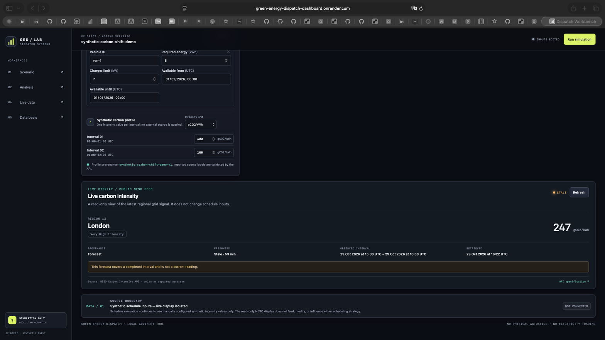
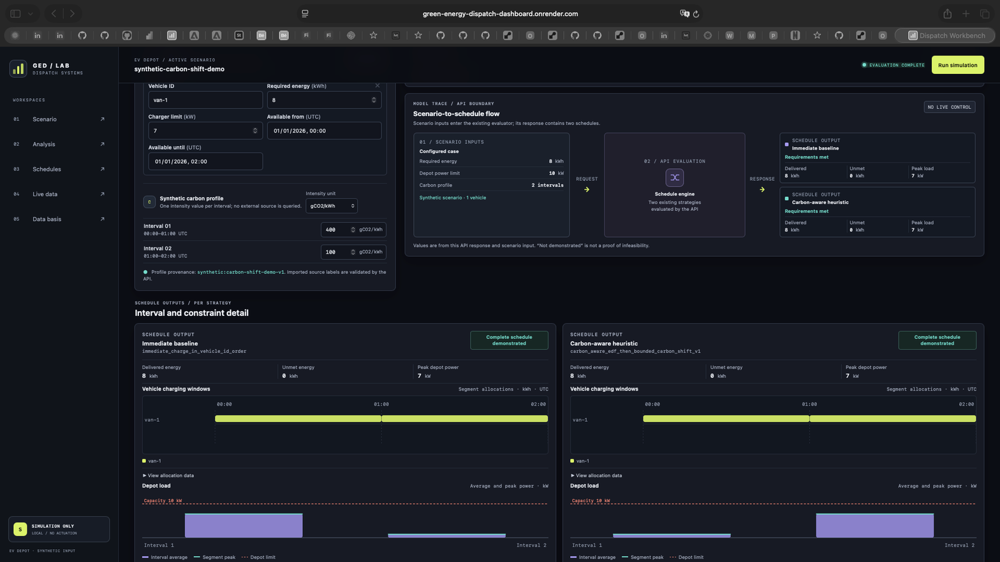

# Green Energy Dispatch v0.2.0-alpha.1 — Phase A pre-release closeout

**Release state:** application deployed; pre-release evidence recorded. This change does not create the `v0.2.0-alpha.1` tag; create it only after the documentation PR is merged and post-merge CI on `main` is green.

This record separates verified application and acceptance evidence from owner-provided Render metadata. It does not claim that the application is a production dispatch service.

## Scope and safety boundary

v0.2.0 Phase A deploys a separate, read-only display of the configured public NESO regional carbon-intensity feed alongside the existing synthetic EV-depot simulation. The displayed signal is not connected to either scheduling strategy. The evaluator remains stateless and synthetic-only: no charger control, physical actuation, electricity trading, measured emissions reduction, or durable user scenario storage is provided.

The documentation closeout changes no application code or dependencies. The v0.1.0 release files and existing tag are preserved unchanged.

## Application source and deployment

- **Application source SHA:** [`efbf1b261bc542e6eed68543a49821511bf95b6a`](https://github.com/vlad12-k/green-energy-dispatch-dashboard/commit/efbf1b261bc542e6eed68543a49821511bf95b6a), on `main`.
- **Render readback supplied by the release owner:** existing `green-energy-dispatch-dashboard` service **Live**, source `efbf1b2`, **Free** instance. The abbreviated source matches the full application SHA above.
- **Evidence boundary:** the provider state above is owner-verified, not independently read from the Render Dashboard during this documentation pass. The public `/health` response does not expose a revision. Auto-Deploy state was not supplied and remains unverified.
- No Render deployment, provider setting, plan, or billing change was made for this closeout.

## GitHub post-merge CI

GitHub Actions run [40904135928 — CI and security](https://github.com/vlad12-k/green-energy-dispatch-dashboard/actions/runs/40904135928) completed successfully on the exact application SHA above. The public check-run readback reported **4/4 SUCCESS**:

| Check | Result |
|---|---|
| `quality` | SUCCESS |
| `frontend-quality` | SUCCESS |
| `container` | SUCCESS |
| `secret-scan` | SUCCESS |

## Production smoke

Executed from a clean checkout at the application source SHA:

```bash
python scripts/smoke_staging.py --base-url https://green-energy-dispatch-dashboard.onrender.com
```

**Exit status: `0`.** Observed results:

| Request / behaviour | Result |
|---|---|
| `GET /health` | `200`; `status=ok`, `environment=production` |
| `GET /` and `/portfolio-smoke-route` | `200`; application shell and SPA history fallback served |
| Three built frontend assets | `200`, served from the same origin |
| `POST /api/v1/simulations/ev-depot/evaluate` | `200`; deterministic synthetic evaluation, `comparison_eligible=true` |
| Synthetic comparison outputs | Baseline proxy `2875`; carbon-aware proxy `950`; difference `1925` proxy units. These are scenario calculations, not measured emissions savings. |
| `POST /api/v1/energy/carbon-intensity` | `405`, `Allow: GET`; no upstream NESO request for this method probe |
| Protected energy route, `/docs`, and `/openapi.json` probes | `404` in simulation-only mode |

The smoke verifies the deployment boundary and deterministic synthetic path; it does not itself fetch live NESO data.

## Bounded public NESO request

One direct, bounded GET was made to `https://api.carbonintensity.org.uk/regional/regionid/13` during acceptance (8-second timeout, 64 KiB response cap, no retry or redirect).

- **HTTP:** `200`; response body 454 bytes.
- **Region:** ID `13`, London.
- **Intensity and unit:** `247 gCO2/kWh` as presented by the application contract. The raw response had no explicit `units` field.
- **Provenance:** `forecast`, not `actual`.
- **Observed interval:** `2026-10-29 15:30–16:00 UTC`, already completed when retrieved.
- **Freshness:** stale (`is_fresh=false`; age from interval start approximately 53.21 minutes). The dashboard labelled it `Stale · 53 min` and warned that the completed-interval forecast was not a current reading.

This request did **not** establish a current actual measurement. Stale data was identified as stale and must not be described as current.

## Apple Safari production acceptance

Apple Safari desktop acceptance at the production URL verified that:

- the live NESO panel displays provenance, freshness, interval and stale-data warning;
- the scheduler boundary is explicit: `Synthetic schedule inputs — live display isolated`, `NOT CONNECTED`;
- the synthetic simulation completes for both existing strategies, each delivering `8 kWh`, with `0 kWh` unmet and `7 kW` peak load; the UI states `NO LIVE CONTROL`.

The following captures are **wide-viewport desktop evidence only**. Each PNG is 1568 × 882 pixels; the CSS viewport and Safari version were not recorded. These images provide no mobile or responsive acceptance evidence.



*Figure 1 — Production live-data display and scheduler boundary. Wide-viewport Safari capture; the completed forecast is labelled stale, and the scheduler is `NOT CONNECTED`.*



*Figure 2 — Completed synthetic simulation in production Safari. Wide-viewport capture; both schedules meet the synthetic requirement and the interface states `NO LIVE CONTROL`.*

## Outstanding limitations and release gate

- **Mobile responsive acceptance: NOT VERIFIED.** No narrow/mobile Safari evidence was collected. The wide-viewport screenshots must not be represented as mobile evidence.
- At the acceptance probe, the NESO response was a stale completed forecast; no current actual value was established.
- Render Auto-Deploy state is unverified; current `Live`, source, and Free-instance metadata above are owner-provided.
- This remains a limited portfolio demonstration without an availability SLA, operational alerting, physical control, trading, or verified real-world emissions outcomes. No complete WCAG or cross-browser conformance claim is made.
- Do not create the `v0.2.0-alpha.1` tag until the documentation PR is merged and post-merge CI on `main` is green. This closeout does not create or move a tag.
